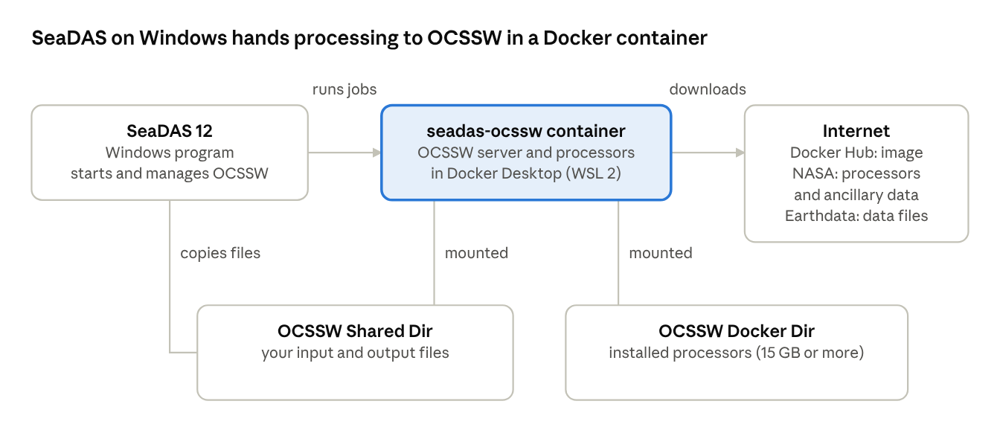

# SeaDAS 12 on Windows – User Guide

Last updated: October 14, 2026 (SeaDAS 12.0.0)

## Overview

On Windows, SeaDAS 12 runs as a normal Windows program, and its science processors (OCSSW: l2gen, l2bin, l3mapgen, the geolocation tools and others) run in a Linux container under Docker Desktop. SeaDAS starts and manages that container for you; you install Docker Desktop once and choose "docker" as the OCSSW location.

What you need:

| Item | Requirement |
| --- | --- |
| Windows | Windows 11, 64-bit |
| Memory | 16 GB recommended. SeaDAS may use up to 12 GB, and processing a PACE OCI file alone takes about 5 GB inside the container |
| Disk | about 1 GB for SeaDAS, 10 GB for OCSSW's shared data, plus each mission (PACE OCI about 5 GB, HawkEye about 0.5 GB), plus your data files. A drive with 30 GB or more free is a good start |
| Docker | Docker Desktop for Windows with the WSL 2 engine |
| Java | only for the installer without a bundled JRE: Java 21 or newer |
| Internet | to download the OCSSW container image (about 350 MB), the processors, ancillary data and Earthdata files |
| Earthdata Login | a free account at urs.earthdata.nasa.gov, saved in a `.netrc` file |



SeaDAS copies your input into the shared folder and asks the container to process it; the container keeps OCSSW in the OCSSW Docker Dir and writes the output to the shared folder.

## Quick start: your first Level-2 image

From a fresh Windows PC to a chlorophyll image takes about an hour and a half, mostly downloads. This path uses SeaHawk HawkEye, the smallest mission to install; the later sections explain each step in more detail.

1. **Install Docker Desktop** with the WSL 2 engine, restart Windows if asked, and start Docker Desktop once (see [Setting up Docker Desktop](#setting-up-docker-desktop)). About 15 minutes.
2. **Save your Earthdata Login** in `C:\Users\YOUR_WINDOWS_NAME\.netrc` (see [Earthdata Login](#earthdata-login)). About 5 minutes.
3. **Install SeaDAS 12** with `seadas_12.0.0_windows64_installer.exe`, keeping all defaults. About 5 minutes.
4. **Start SeaDAS 12** from the SeaDAS 12 desktop shortcut.
5. **Choose Docker:** SeaDAS-Toolbox > SeaDAS Processor Location... > OCSSW Location **docker**. Set OCSSW Docker Dir to a drive with at least 20 GB free, then click **OK** and wait for "OCSSW server is up". A few minutes the first time.
6. **Install the processors:** SeaDAS-Toolbox > Install/Update SeaDAS Processors... > tick **HawkEye** > **Run**. Set Windows sleep to Never first; about 10.5 GB, 20 to 60 minutes.
7. **Get a test file:** Earthdata-Cloud > Earthdata Cloud Data Browser > satellite HAWKEYE, level L1 > Search > select one file > Download. About 180 MB.
8. **Geolocate it:** SeaDAS-Toolbox > SeaDAS Processors > HawkEye > geolocate_hawkeye > choose the downloaded L1A file > Run. A GEO file appears next to it.
9. **Make the Level-2 file:** SeaDAS-Toolbox > SeaDAS Processors > l2gen > choose the same L1A file. Check that the output name fills in (`…L2.OC.nc`), click **Get Ancillary**, then **Run**. About 10 minutes.
10. **Look at the result:** File > Open Product > the `L2.OC.nc` file next to your input > open the `chlor_a` band.

If a step does not behave as described, see [Troubleshooting](#troubleshooting): the messages there match what SeaDAS shows.

## Installing SeaDAS 12

Download one of the two Windows installers from the [SeaDAS 12.0.0 Download](https://github.com/seadas/seadas-toolbox/wiki/SeaDAS-12.0.0-Download) page; most users want the one with the bundled Java:

| Installer | Use it when |
| --- | --- |
| `seadas_12.0.0_windows64_installer.exe` | you want everything in one package (recommended) |
| `seadas_12.0.0_windows64_installer_no_bundled_jre.exe` | you already have Java 21 or newer installed and want a smaller download |

1. Close any running SeaDAS. The installer cannot replace files that are in use.
2. Run the installer. Windows may show "Windows protected your PC" because the installer is not code-signed yet: click **More info**, then **Run anyway**.
3. Accept the administrator prompt. SeaDAS installs into `C:\Program Files\SeaDAS`.
4. Without a bundled JRE, the installer shows a **Select Java** page, filled in with the first Java 21+ it finds (`JAVA_HOME`, or the Oracle and Adoptium installs). Choose another folder if needed; anything older than Java 21 is refused. See also the [SeaDAS User Guide for Installers Without Bundled JRE](https://github.com/seadas/seadas-toolbox/wiki/SeaDAS-User-Guide-for-Installers-Without-Bundled-JRE).
5. Keep **Create a desktop shortcut** ticked (the default) if you want one.

Start SeaDAS from the **SeaDAS 12** shortcut on the desktop or in the Start menu.

**Next to an older SeaDAS.** SeaDAS 12 installs beside SeaDAS 11 or 10 and leaves them alone; their shortcuts are named "SeaDAS", SeaDAS 12's are "SeaDAS 12". In Settings > Apps, SeaDAS 12 may appear as "SeaDAS version 12.0.0 (64-bit)" when SeaDAS 11 is also installed. All versions share your settings folders (`%USERPROFILE%\.seadas` and `%APPDATA%\.seadas`).

**Uninstalling.** Close SeaDAS 12, then use Settings > Apps > SeaDAS version 12.0.0 > Uninstall, or run `C:\Program Files\SeaDAS\unins000.exe`. Your settings folders and your OCSSW folder are kept.

**Unattended install (IT staff).** Run the installer with `/VERYSILENT`. Add `/MERGETASKS="!desktopicon"` to skip the desktop shortcut, and for the installer without a JRE, `/JAVAHOME="C:\path\to\jdk-21"`. A silent install stops with exit code 7 if it finds no Java 21 or newer.

## Earthdata Login

SeaDAS and OCSSW download data, ancillary files and processors with your NASA Earthdata Login, read from a file named `.netrc` in your user folder. Create a free account at [urs.earthdata.nasa.gov](https://urs.earthdata.nasa.gov) first.

1. Open Notepad and type one line, with your own user name and password:

   ```
   machine urs.earthdata.nasa.gov login YOUR_USERNAME password YOUR_PASSWORD
   ```

2. Save it as `C:\Users\YOUR_WINDOWS_NAME\.netrc`, with **Save as type: All files**, so that Notepad does not add `.txt`. In Explorer, turn on View > File name extensions to check the name is exactly `.netrc`.
3. When you change your Earthdata password, change it in this file too. SeaDAS copies the file into the OCSSW container whenever it starts or restarts the container, so the new password is used from then on.

An outdated password shows up as "Earthdata login failed" in the Earthdata Cloud Data Browser, and as failed ancillary downloads in the processors.

## Setting up Docker Desktop

Docker Desktop runs the OCSSW container. You install it once; after that SeaDAS starts it when needed.

1. Install WSL 2 if it is not there yet: open PowerShell as administrator, run `wsl --install`, and restart Windows.
2. Download and install Docker Desktop from [docs.docker.com](https://docs.docker.com/desktop/setup/install/windows-install/). Keep **Use WSL 2 instead of Hyper-V** selected.
3. Start Docker Desktop once, accept its terms, and wait until it reports that the engine is running.
4. Check it from PowerShell: `docker version` should print a client and a server section.

With the WSL 2 engine, Docker can use folders on any of your drives, so you can keep OCSSW on a drive other than C:. Docker Desktop must be running while you process data; if it is not, SeaDAS tries to start it, and otherwise asks you to.

## Using OCSSW in Docker

Tell SeaDAS once that OCSSW runs in Docker; from then on it starts the container whenever it needs it.

1. In SeaDAS 12, open **SeaDAS-Toolbox > SeaDAS Processor Location...**.
2. Set **OCSSW Location** to **docker**.
3. Check the two folders, and change them if you like:

   | Setting | What it holds | Default |
   | --- | --- | --- |
   | OCSSW Docker Dir | the installed processors and their data, 15 GB or more | `C:\Users\YOU\ocssw-docker` |
   | OCSSW Shared Dir | your input files copied for processing, and the outputs | `C:\Users\YOU\seadasClientServerShared` |

4. Click **OK**. SeaDAS runs its start script: it downloads the `seadas/ocssw-run:12.0.0` image the first time (about 350 MB), creates both folders, copies your `.netrc` into the shared folder, and starts the container. A progress window shows each step.

**Choose the OCSSW folder by free space.** OCSSW grows to 15 GB or more with a few missions. If C: is short of space, point OCSSW Docker Dir at another drive, for example `E:\ocssw-docker`, before installing the processors.

**What happens automatically from then on.** When SeaDAS starts, or when you run a processor and the container is not answering, SeaDAS starts Docker Desktop if needed and starts the container. When you change a folder, the image or a port and click OK, SeaDAS recreates the container with the new settings. You don't need to run any Docker commands yourself.

To set up the container by hand instead, see the start script `C:\Program Files\SeaDAS\bin\start_ocssw_docker.ps1` (run it with `-?` or read its header).

## Installing the science processors

The container starts empty; you install OCSSW into the OCSSW Docker Dir from SeaDAS. Installed missions stay there when the container or SeaDAS is updated.

1. Open **SeaDAS-Toolbox > Install/Update SeaDAS Processors...**.
2. Keep the suggested OCSSW tag (V2026.5 for SeaDAS 12.0.0) and tick the missions you need. Missions already installed are shown as such.
3. Click **Run** and leave SeaDAS open until it says the installation is done.

Sizes measured on a V2026.5 install:

| Package | Download on disk |
| --- | --- |
| Shared data (installed with any mission) | about 10 GB |
| PACE OCI | about 4.6 GB |
| Landsat 8 OLI | a few GB |
| SeaHawk HawkEye | about 0.45 GB |

A first install with PACE OCI therefore downloads 15 GB or more, which takes from about 20 minutes to well over an hour depending on your connection.

**It is not frozen.** The progress bar only moves when the next package starts ("Installing (8 of 11) - oci"), so it can stand still for a long time during a large package.

**Keep the computer awake.** Windows usually sleeps after 30 minutes without use, and sleep breaks the download. Set Settings > System > Power & sleep > Sleep to **Never** for the install, and set it back afterwards.

**If it stops with an error** such as "Connection reset by peer" or "install_ocssw failed with exit code 1", the download was interrupted. Run the installer again with the same missions: it keeps what is already complete and continues with the rest.

## Processing data: a HawkEye example

Processing a SeaHawk HawkEye Level-1A file to Level-2 takes three steps, all from the **SeaDAS-Toolbox > SeaDAS Processors** menu. Other missions work the same way; some skip the geolocation step.

1. **geolocate_hawkeye** (under HawkEye): choose the L1A file as input. It writes a GEO file next to it, for example `SEAHAWK1_HAWKEYE.20230624T143116.GEO.nc`. It needs two time-correction files, which SeaDAS's OCSSW server downloads by itself.
2. **l2gen**: choose the same L1A file. SeaDAS fills in the GEO file and the output name (`…L2.OC.nc`). If the output name stays empty, OCSSW is not working; see Troubleshooting.
3. In l2gen, click **Get Ancillary** to download the matching meteorology, ozone and sea-surface-temperature files (optional: without them l2gen uses climatology). Then click **Run**.

Where the files go: SeaDAS copies the input into the OCSSW Shared Dir, OCSSW writes the output there, and SeaDAS copies the result back next to your input file. You find the output in the folder you picked the input from, and a copy in the shared folder.

Typical run times measured on a 2012 quad-core desktop: about 10 minutes for a full HawkEye scene (5,936 lines), about 40 minutes for a PACE OCI Level-1B granule. l2gen uses one processor core, so a newer computer is noticeably faster. To test quickly, limit l2gen to a smaller area or scan-line range.

## Finding and downloading data

The **Earthdata Cloud Data Browser** (menu **Earthdata-Cloud**, or **SeaDAS-Toolbox > Earthdata-Cloud**) searches NASA's OB_CLOUD collections and downloads the files you select.

- **Search:** pick a satellite/instrument, data level and product (several products at once if you like), a date range and an area, then search. A keyword filters on file names.
- **Download:** select files and click **Download**; choose a folder, and SeaDAS also saves the list of file URLs there. **URLs Only** saves just the list. Level-2 results also offer **Subset** (spatial or variable subsets through NASA's Harmony service).
- **Up-to-date mission list:** each time the browser opens, it refreshes the list of missions and products from NASA's CMR in the background, so newly released collections appear without a SeaDAS update. Each mission shows its valid date range.
- **Login problems:** if Earthdata rejects the user name or password in your `.netrc`, the download stops at once with "Earthdata login failed" and the path of the file to fix. Files that fail for other reasons are listed with the reason when the download ends.

## Troubleshooting

| What you see | Likely cause | What to do |
| --- | --- | --- |
| "OCSSW Not Installed" when opening a processor | no OCSSW in the OCSSW Docker Dir | Install the processors, or set OCSSW Docker Dir to the folder that already holds OCSSW and click OK |
| l2gen's output name stays empty | OCSSW cannot read the input; an old copy of the container image lacked the file-type tool | In PowerShell: `docker pull seadas/ocssw-run:12.0.0`, then `docker rm -f seadas-ocssw`, then restart SeaDAS |
| geolocate_hawkeye: "/root/ocssw/var/modis/utcpole.dat not found" | A copy of the container image from before 13 October 2026, which does not fetch the time files yet, or no internet access from the container | In PowerShell: `docker pull seadas/ocssw-run:12.0.0`, then `docker rm -f seadas-ocssw`, then restart SeaDAS and run it again |
| "SeaDAS could not start the OCSSW Docker container" | Docker Desktop missing or not running, or the image could not be downloaded | Follow the reason shown under the message; check Docker Desktop is running and you are online |
| "Remote server is down. OCSSW is not accessible." | the container is not answering | Start Docker Desktop; then reopen SeaDAS-Toolbox > SeaDAS Processor Location... and click OK |
| "Earthdata login failed" | outdated or mistyped password in `.netrc` | Fix `C:\Users\YOU\.netrc`, then try again |
| "install_ocssw failed" with "Connection reset by peer" | the download was interrupted | Run the installer again; it continues where it stopped |
| Disk full while installing | OCSSW is on a drive with too little space | Choose an OCSSW Docker Dir on a larger drive and install again (see the note below) |
| "Windows protected your PC" | the installer is not code-signed yet | Click More info, then Run anyway |
| Processing is slow | l2gen uses one processor core | Expected on older computers; limit the area or scan lines for tests |

**Moving an existing OCSSW folder.** OCSSW contains thousands of Linux links. Windows tools (Explorer, copy, robocopy) cannot copy them correctly, and a copy made that way breaks OCSSW. Install OCSSW again in the new folder instead, or ask your SeaDAS contact for the Docker-based copy steps.

Where the logs are:

| Log | Location |
| --- | --- |
| SeaDAS | `%APPDATA%\.seadas\var\log\messages.log` |
| Starting the container | `%USERPROFILE%\.seadas\log\ocssw_docker_start.log` |
| A processor run | `OCSSW_LOG_<program>.txt`, next to your input file |
| The OCSSW server in the container | PowerShell: `docker logs seadas-ocssw` |

## Known issues in 12.0.0

- **Not code-signed:** the Windows installers show "Windows protected your PC" until they are signed.
- **Install progress:** the processor installer reports progress per package only, so large packages look stalled.
- **Memory on 12 GB computers:** SeaDAS may use up to 12 GB and processing PACE OCI takes about 5 GB in the container. On a 12 GB computer, close other programs while processing large files.
- **Older container image:** a computer that downloaded `seadas/ocssw-run:12.0.0` before 13 October 2026 has a copy without the file-type tool, and l2gen gets no output name. Update it as shown in Troubleshooting.
